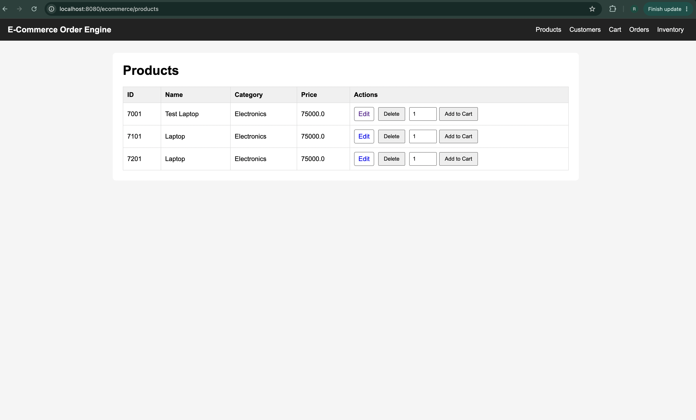
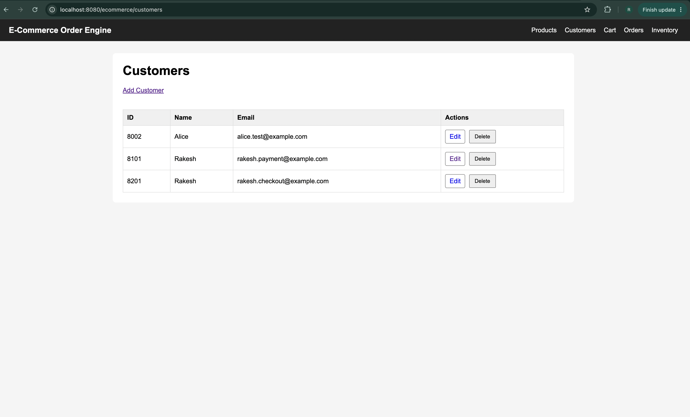
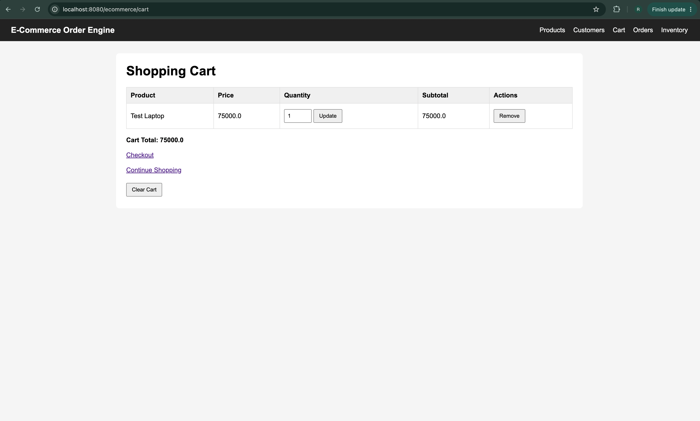
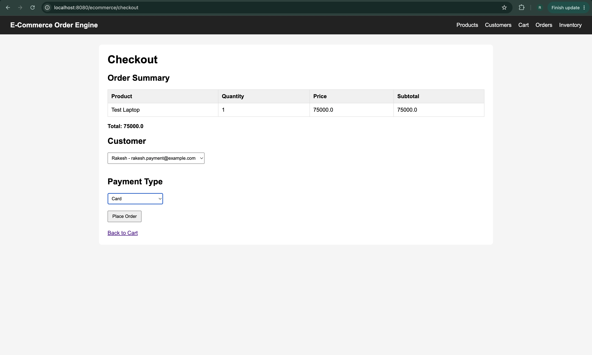
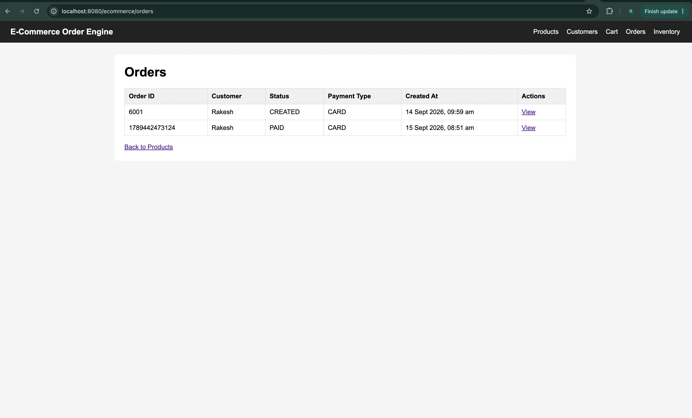
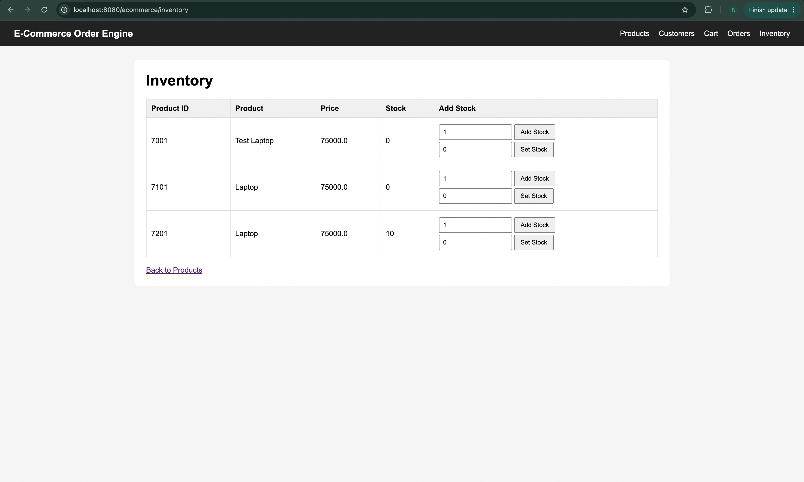

# High-Throughput E-Commerce Order Processing & Analytics Engine

## Overview

`ECommerceOrderEngine` is a full-stack e-commerce application developed progressively from a Core Java order-processing engine into a secure, database-backed, cloud-deployed application.

The project demonstrates the evolution of enterprise application development through Java, JDBC, Servlets, Hibernate, Spring Boot, REST APIs, React, Spring Security, and AWS.

Rather than building separate applications for each technology, the project progressively introduces new architectural layers, persistence mechanisms, security capabilities, and infrastructure.

**Current Version: V7**

**Live Application:** https://dsohu6n1v0a1o.cloudfront.net

### Technology Stack

| Layer | Technologies |
|---|---|
| Frontend | React, JavaScript, Vite, HTML, CSS |
| Backend | Java 21, Spring Boot 4.1.1 |
| REST API | Spring Web MVC |
| Persistence | Spring Data JPA, Hibernate |
| Database | MySQL |
| Security | Spring Security, JWT, Google OAuth2 |
| Bot Protection | Google reCAPTCHA Enterprise |
| Logging | Log4j2 |
| Cross-Cutting Concerns | Spring AOP |
| Monitoring | Spring Boot Actuator, Micrometer |
| Database Migrations | Flyway |
| Testing | JUnit 5, Mockito, Spring Boot Test |
| Cloud | AWS EC2, RDS, S3, CloudFront |
| Reverse Proxy | Nginx |
| Build Tools | Maven, npm, Vite |

---

## Project Evolution

| Version | Implementation |
|---|---|
| V1 | Core Java, OOP, concurrency and design patterns |
| V2 | Maven, JDBC, MySQL and database transactions |
| V3 | Servlets, JSP, JSTL and Apache Tomcat |
| V4 | Hibernate ORM and JPA |
| V5 | Spring Framework and Spring Boot |
| V6 | REST APIs, Spring Data JPA, React and Spring AOP |
| V7 | Spring Security, JWT, OAuth2, Log4j2, monitoring and AWS |
| V8 | Spring AI (Planned) |
| V9 | Docker and Microservices (Planned) |
| V10 | Kubernetes, Docker and Jenkins CI/CD (Planned) |

---

# V1 – Core Java

V1 implements the e-commerce order-processing system using Core Java and in-memory data structures.

The objective of this version was to establish a strong foundation in object-oriented programming, design patterns, concurrency, and application business logic.

## V1 Features

- Product and customer management
- Shopping cart operations
- In-memory inventory management
- Thread-safe inventory reservation
- Concurrent checkout processing
- Card, UPI and Wallet payment strategies
- Checkout rollback handling
- Order creation using Builder pattern
- Payment Strategy pattern
- Payment Factory
- Observer-based order notifications
- Analytics processing
- CSV persistence
- Java serialization
- Custom exceptions
- Unit and concurrency testing

## Core Java Concepts

- Object-Oriented Programming
- Java Collections Framework
- Streams API
- Lambda Expressions
- Optional
- Exception Handling
- File I/O
- Java Serialization
- ConcurrentHashMap
- ExecutorService
- CountDownLatch
- AtomicInteger
- JUnit 5
- SOLID Principles
- Design Patterns

## V1 Architecture

```text
                  Customer
                     |
                     v
                Shopping Cart
                     |
                     v
               CheckoutService
                     |
          +----------+----------+
          |          |          |
          v          v          v
      Inventory   Payment     Order
       Service    Processor   Creation
          |          |          |
          +----------+----------+
                     |
                     v
              Order Notification
                     |
                     v
                  Analytics
```

## Design Patterns

### Strategy Pattern

Used to support multiple payment implementations:

```text
PaymentStrategy
     |
     +---- CardPaymentStrategy
     |
     +---- UpiPaymentStrategy
     |
     +---- WalletPaymentStrategy
```

### Factory Pattern

`PaymentFactory` selects the appropriate payment strategy.

### Builder Pattern

Used to construct `Order` objects.

### Observer Pattern

Used for order notifications and analytics processing.

## Concurrency

V1 uses Java concurrency utilities to support multiple checkout requests.

Important concurrency components include:

```text
ExecutorService
CountDownLatch
ConcurrentHashMap
AtomicInteger
```

The checkout implementation demonstrates thread-safe stock reservation and prevents multiple threads from purchasing more stock than is available.

---

# V2 – Maven + JDBC + MySQL

V2 extends the Core Java application by introducing persistent relational storage and transaction-based checkout processing.

Instead of storing application state only in memory, products, customers, inventory, orders, order items and payments are persisted in MySQL.

## V2 Features

- Maven-based project structure
- MySQL integration
- JDBC connectivity
- Repository pattern
- Product CRUD operations
- Customer CRUD operations
- Persistent inventory management
- Atomic stock reservation
- Persistent orders and order items
- Payment persistence
- SQL JOIN queries
- Batch insertion of order items
- JDBC transaction management
- Commit and rollback handling
- Foreign key constraints
- Database validation constraints
- Concurrent database checkout processing
- Prevention of inventory overselling
- Environment-variable-based database credentials
- Database integration testing

## V2 Architecture

```text
                   Application
                        |
                        v
                 JdbcCheckoutService
                        |
           +------------+------------+
           |            |            |
           v            v            v
      InventoryRepo   OrderRepo   PaymentRepo
           |            |            |
           v            v            v
      JDBC Inventory JDBC Order  JDBC Payment
           |            |            |
           +------------+------------+
                        |
                        v
                       JDBC
                        |
                        v
                      MySQL
```

The checkout service handles the business workflow, while repositories handle SQL and persistence operations.

## Transactional Checkout

V2 performs checkout using a single JDBC connection and database transaction.

```text
BEGIN TRANSACTION
        |
        v
Reserve Inventory
        |
        v
Calculate Order Total
        |
        v
Process Payment
        |
        v
Create Order
        |
        v
Save Order Items
        |
        v
Save Payment
        |
        v
COMMIT
```

If any operation fails:

```text
Failure
   |
   v
ROLLBACK
   |
   +---- Restore inventory changes
   |
   +---- Prevent partial order persistence
   |
   +---- Prevent partial payment persistence
```

## ACID Transaction Concepts

### Atomicity

Checkout operations succeed together or are rolled back together.

### Consistency

Foreign keys, validation and database constraints preserve valid data.

### Isolation

Concurrent checkout transactions must not oversell inventory.

### Durability

Successfully committed orders and payments remain stored in MySQL.

## Atomic Inventory Reservation

The database uses conditional stock updates:

```sql
UPDATE inventory
SET quantity = quantity - ?
WHERE product_id = ?
  AND quantity >= ?;
```

This prevents concurrent checkout requests from purchasing unavailable stock.

## Concurrency Integration Testing

A historical V2 test scenario:

```text
Initial inventory: 50

Concurrent checkout attempts: 100
Worker threads: 20

Successful checkouts: 50
Rejected checkouts: 50

Final inventory: 0
Orders committed: 50
Payments committed: 50
```

## Repository Pattern

```text
ProductRepository
    |
    +---- JdbcProductRepository

CustomerRepository
    |
    +---- JdbcCustomerRepository

InventoryRepository
    |
    +---- JdbcInventoryRepository

OrderRepository
    |
    +---- JdbcOrderRepository

PaymentRepository
    |
    +---- JdbcPaymentRepository
```

## Database Schema

The relational schema includes:

```text
products
customers
inventory
orders
order_items
payments
```

The main relationships are:

```text
Customer
   |
   v
 Orders
   |
   +------ OrderItems
   |
   +------ Payments

Product
   |
   +------ Inventory
   |
   +------ OrderItems
```

---

# V3 – Servlets + JSP + Tomcat

V3 converts the JDBC-backed application into a server-rendered web application using Jakarta Servlets, JSP and Apache Tomcat.

The existing V2 checkout logic and repository implementations are reused instead of rewriting the business layer.

## V3 Features

- Apache Tomcat deployment
- WAR packaging
- Jakarta Servlet API
- JSP views
- JSTL and Expression Language
- Product CRUD through web pages
- Customer CRUD through web pages
- Session-based shopping cart
- Add, update, remove and clear cart operations
- Transactional checkout
- Order success page
- Order history and order details
- Inventory dashboard
- Stock updates
- Friendly HTTP error handling
- Shared navigation and CSS
- Separate development and test databases

## V3 Architecture

```text
                  Browser
                     |
                     v
                Apache Tomcat
                     |
                     v
                   Servlets
                     |
           +---------+----------+
           |                    |
           v                    v
        JSP Views        Application Services
                                |
                                v
                       JdbcCheckoutService
                                |
                       JDBC Repositories
                                |
                                v
                              MySQL
```

## Servlet and JSP Flow

```text
Browser Request
       |
       v
     Servlet
       |
       +---- Validate request
       |
       +---- Execute service operation
       |
       +---- Prepare request attributes
       |
       v
       JSP
       |
       +---- JSTL
       |
       +---- Expression Language
       |
       v
  HTML Response
```

The JSP pages use JSTL and EL to avoid embedding business logic directly in the view layer.

## Product and Customer CRUD

```text
Products

GET  /products
GET  /products/new
POST /products
GET  /products/edit?id=...
POST /products/edit
POST /products/delete

Customers

GET  /customers
GET  /customers/new
POST /customers
GET  /customers/edit?id=...
POST /customers/edit
POST /customers/delete
```

## Session-Based Shopping Cart

Cart data is stored in `HttpSession`.

```text
Browser
   |
   v
Tomcat Session
   |
   v
Shopping Cart
   |
   +---- CartItem
   |
   +---- CartItem
   |
   +---- CartItem
```

Supported operations include:

```text
POST /cart/add
GET  /cart
POST /cart/update
POST /cart/remove
POST /cart/clear
```

## Transactional Checkout

The Servlet layer delegates checkout processing to the existing JDBC checkout service.

```text
Session Cart
     |
     v
CheckoutServlet
     |
     v
JdbcCheckoutService
     |
     +---- Reserve Inventory
     |
     +---- Calculate Total
     |
     +---- Process Payment
     |
     +---- Persist Order
     |
     +---- Persist Payment
     |
     v
COMMIT
```

On failure, the database transaction rolls back.

## Development and Test Isolation

```text
Web Application
      |
      v
  ecommerce_db


Automated Tests
      |
      v
ecommerce_test_db
```

This prevents automated database cleanup from interfering with manually created application data.

## V3 Screenshots

### Products



### Customers



### Shopping Cart



### Checkout



### Orders



### Inventory



---

# V4 – Hibernate + JPA

V4 migrates the active persistence layer from direct JDBC repository implementations to Hibernate ORM and Jakarta Persistence (JPA).

The Servlet/JSP web layer remains in place.

Hibernate replaces the manual persistence implementations while preserving transaction guarantees and preventing inventory overselling.

## V4 Goals

- Preserve existing V3 functionality
- Replace active JDBC persistence with Hibernate/JPA
- Maintain the existing MySQL schema
- Preserve atomic inventory reservation
- Maintain transactional checkout
- Preserve rollback behavior
- Prevent concurrent inventory overselling
- Maintain historical order pricing
- Preserve development/test database isolation
- Add Hibernate integration tests

## JPA Entity Model

```text
Product
Customer
Order
OrderItem
Inventory
Payment
```

Main relationships:

```text
Customer 1 ----- * Order
Order    1 ----- * OrderItem
Product  1 ----- * OrderItem
Product  1 ----- 1 Inventory
Order    1 ----- * Payment
```

`OrderItem` uses a composite embedded key:

```text
OrderItemId
   |
   +---- orderId
   |
   +---- productId
```

## Hibernate Configuration

Hibernate is configured to validate the existing database schema rather than automatically replace it.

```xml
<property name="hibernate.hbm2ddl.auto">
    validate
</property>
```

## V4 Repository Architecture

```text
ProductRepository
    |
    +---- JdbcProductRepository
    |
    +---- HibernateProductRepository

CustomerRepository
    |
    +---- JdbcCustomerRepository
    |
    +---- HibernateCustomerRepository

InventoryRepository
    |
    +---- JdbcInventoryRepository
    |
    +---- HibernateInventoryRepository

OrderRepository
    |
    +---- JdbcOrderRepository
    |
    +---- HibernateOrderRepository

PaymentRepository
    |
    +---- JdbcPaymentRepository
    |
    +---- HibernatePaymentRepository
```

The JDBC implementations remain available as historical implementations, while the V4 application uses Hibernate repositories.

## V4 Architecture

```text
Browser
   |
   v
Apache Tomcat
   |
   v
Servlets + JSP
   |
   v
Application Services
   |
   v
HibernateCheckoutService
   |
   v
Hibernate Repositories
   |
   v
Hibernate / JPA
   |
   v
MySQL
```

## Transaction Management

V4 uses a shared Hibernate `Session` and `Transaction` to execute checkout atomically.

```text
BEGIN TRANSACTION
        |
        v
Reserve Inventory
        |
        v
Calculate Total
        |
        v
Process Payment
        |
        v
Persist Order and Items
        |
        v
Persist Payment
        |
        v
COMMIT
```

A failure triggers rollback.

## Historical Pricing

Order items preserve the price at the time of purchase.

```text
Product.price
    |
    +---- Current catalogue price

OrderItem.unitPrice
    |
    +---- Historical purchase price
```

This prevents future product-price changes from altering historical order values.

## V4 Testing

Hibernate tests cover:

- Product repository operations
- Customer repository operations
- Inventory repository operations
- Order repository operations
- Payment repository operations
- Successful checkout
- Insufficient stock
- Payment failure
- Transaction rollback
- Concurrent stock reservation

---

# V5 – Spring Framework + Spring Boot

V5 introduces the Spring Framework and Spring Boot into ECommerceOrderEngine.

The objective is to move from manually configured application infrastructure toward Spring-managed components, dependency injection, configuration and application lifecycle management.

## V5 Features

- Spring Framework integration
- Spring Boot application initialization
- Spring dependency injection
- Inversion of Control
- Spring-managed service components
- Component scanning
- Constructor-based dependency injection
- Configuration through application properties
- Spring application context
- Embedded application server
- Maven-based Spring Boot builds
- Preparation for REST APIs and Spring Data JPA

## Dependency Injection

Spring manages the dependencies between controllers, services and repositories.

```text
Spring Application Context
          |
          v
      Controller
          |
          v
        Service
          |
          v
      Repository
```

Constructor injection is used to provide dependencies rather than creating service and repository objects manually throughout the application.

## Spring Boot Application Structure

```text
EcommerceApplication
        |
        v
Spring Boot
        |
        +---- Component Scanning
        |
        +---- Dependency Injection
        |
        +---- Auto Configuration
        |
        +---- Embedded Tomcat
        |
        +---- Application Properties
```

## Spring Concepts Demonstrated

- Inversion of Control
- Dependency Injection
- Application Context
- Bean Management
- Component Scanning
- Autoconfiguration
- Service Layer Abstraction
- Environment-Based Configuration
- Embedded Server Deployment

V5 establishes the framework foundation used by V6 and V7.

---

# V6 – REST APIs + Spring Data JPA + React + Spring AOP

V6 extends the Spring Boot application into a full-stack application with a React frontend and REST-based communication.

It also introduces **Spring AOP** for cross-cutting functionality such as method logging, execution-time measurement and auditing.

## V6 Backend Features

- Spring Boot REST controllers
- Spring Web MVC
- RESTful endpoints
- JSON request and response bodies
- Spring Data JPA repositories
- Hibernate-based persistence
- DTO-based API contracts
- Request validation
- Exception handling
- Service layer architecture
- Product management
- Customer management
- Inventory management
- Order management
- Transactional checkout processing
- Maven-based application packaging

## V6 REST Architecture

```text
React Frontend
      |
      | HTTP / JSON
      v
Spring Boot REST API
      |
      v
REST Controllers
      |
      v
Service Layer
      |
      v
Spring Data JPA
      |
      v
Hibernate ORM
      |
      v
MySQL
```

## REST API Modules

### Products

```text
GET     /api/products
POST    /api/products
PUT     /api/products/{id}
DELETE  /api/products/{id}
```

Additional endpoints support product-price management.

### Inventory

Inventory APIs support stock retrieval and authorized stock updates.

### Orders

Order APIs support order retrieval, order items and order-status updates.

### Customers

Customer APIs support customer management and account-associated profile operations.

## React Frontend

V6 introduces a React frontend using Vite.

The frontend communicates with Spring Boot using REST APIs.

### Storefront Features

- Homepage
- Product catalogue
- Product filtering and sorting
- Shopping cart
- Quantity updates
- Checkout interface
- Order history
- Responsive navigation

### Management Features

- Administrative dashboard
- Product management
- Customer management
- Inventory management
- Order management

## React Application Architecture

```text
React Application
       |
       +---- Pages
       |
       +---- Components
       |
       +---- Context Providers
       |
       +---- API Services
       |
       +---- React Router
       |
       v
Spring Boot REST APIs
```

## Spring AOP

Spring Aspect-Oriented Programming is introduced in V6 to separate cross-cutting concerns from application business logic.

The AOP implementation includes method logging, performance measurement and auditing functionality.

### MethodLoggingAspect

Records method execution events.

```text
Controller / Service Method
          |
          v
      AOP Advice
          |
          +---- Method Entry
          |
          +---- Method Exit
          |
          +---- Success / Failure
```

### PerformanceMetricsAspect

Measures method execution time.

Example:

```text
ENTER ProductController.getAllProducts()

PERFORMANCE ProductController.getAllProducts()
Execution Time: 64 ms

EXIT ProductController.getAllProducts()
SUCCESS
```

### Auditing

The AOP design supports auditing of selected application operations.

Auditing should record relevant operational information without logging passwords, JWTs, OAuth authorization codes or other credentials.

### Why Spring AOP?

- Separates logging from business logic
- Reduces duplicate cross-cutting code
- Supports performance analysis
- Improves maintainability
- Makes operational behavior easier to observe

## V6 Design Principles

- Layered Architecture
- Separation of Concerns
- Dependency Injection
- Repository Pattern
- DTO Pattern
- Transaction Management
- Aspect-Oriented Programming
- RESTful API Design
- Reusable React Components

---

# V7 – Spring Security + Log4j2 + Monitoring + AWS

**Current Version**

V7 introduces authentication, authorization, identity management, production-style logging, monitoring and cloud deployment.

The application runs as a three-tier full-stack system with React, Spring Boot and MySQL.

## V7 Features

- Spring Security
- JWT authentication
- Google OAuth2 / OpenID Connect
- Google reCAPTCHA Enterprise
- Role-based access control
- Permission-based authorization
- Resource ownership restrictions
- Customer order isolation
- Role assignment and removal
- Account administration
- Product image upload and management
- Amazon S3 product image storage
- Log4j2 logging
- Spring Boot Actuator
- Micrometer monitoring
- Flyway database migrations
- Automated security and integration testing
- AWS deployment

## V7 Three-Tier Architecture

```text
                 User / Browser
                       |
                       v
               Amazon CloudFront
                       |
            +----------+-----------+
            |                      |
            v                      v
      Amazon S3                HTTPS Origin
    React Frontend                 |
                                   v
                              Nginx (EC2)
                                   |
                                   v
                           Spring Boot REST API
                                   |
                                   v
                             Amazon RDS
                                MySQL
```

Product images are stored separately:

```text
React
   |
   v
Spring Boot Image API
   |
   +---- Image Metadata -> MySQL RDS
   |
   +---- Image Content  -> Amazon S3
```

## AWS Infrastructure

| Service | Responsibility |
|---|---|
| Amazon CloudFront | HTTPS frontend delivery and API routing |
| Amazon S3 | React build assets |
| Amazon EC2 | Spring Boot backend |
| Amazon RDS | MySQL database |
| Amazon S3 (Images) | Product image storage |
| Nginx | HTTPS reverse proxy |
| systemd | Backend process management |

### Live Application

https://dsohu6n1v0a1o.cloudfront.net

The current deployment uses an existing EC2 backend rather than a highly available multi-instance cluster.

Infrastructure changes are managed with an approximately $35/month AWS budget constraint.

---

## Spring Security

Spring Security protects application operations using authenticated identity, roles and permissions.

### Authentication

Supported authentication methods:

1. Email and password with JWT
2. Google OAuth2 / OpenID Connect

### Authorization

Four application roles are defined:

```text
ROOT
SELLER_ADMIN
IT_SUPPORT
CUSTOMER
```

Permissions are associated with roles.

Administrative permissions are independent of normal shopping capabilities.

## Role-Based Permissions

| Functionality | CUSTOMER | SELLER_ADMIN | IT_SUPPORT | ROOT |
|---|---|---|---|---|
| Browse products | Yes | Yes | Yes | Yes |
| Manage own cart | Yes | Yes | Yes | Yes |
| Checkout | Yes | Yes | Yes | Yes |
| View own orders | Yes | Yes | Yes | Yes |
| Create products | No | Yes | No | Yes |
| Update owned products | No | Yes | No | Yes |
| Manage owned inventory | No | Yes | No | Yes |
| Manage all inventory | No | No | No | Yes |
| Manage product images | No | Owned products | No | All products |
| Read seller orders | No | Own seller orders | No | Yes |
| Manage user accounts | No | No | Authorized actions | Yes |
| Assign and remove roles | No | No | Yes | Yes |
| Full administration | No | No | No | Yes |

Every authenticated role can also act as a normal shopper.

ROOT receives every permission and can access account and role administration.

IT_SUPPORT does not receive product-inventory or product-image management permissions.

Administrative actions and role assignment must be independently authorized by the backend.

---

## JWT Authentication

JWT authentication provides stateless API access.

```text
User Login
    |
    v
Spring Security
    |
    v
Credential Verification
    |
    v
JWT Generation
    |
    v
React Stores Authentication State
    |
    v
Authenticated API Requests
```

JWT authorization uses the authenticated user's current permissions and account information.

Inactive accounts must not receive new authentication tokens.

## Google OAuth2

Google OAuth2 enables users to authenticate through Google's identity provider.

The implementation uses Spring Security OAuth2 and OpenID Connect.

### Google Login Flow

```text
React Login
     |
     v
Continue with Google
     |
     v
Spring Security OAuth2
     |
     v
Google Accounts
     |
     v
Google OIDC Callback
     |
     v
GoogleOAuth2AccountService
     |
     v
Temporary One-Time Login Code
     |
     v
React GoogleAuthCallback
     |
     v
JWT Exchange Endpoint
     |
     v
Authenticated User
```

### Security Controls

- Verified Google email required
- Stable Google OIDC subject used for identity
- Existing LOCAL accounts are not automatically linked by email
- New Google accounts receive CUSTOMER role
- Account status is validated
- Temporary login codes are session-bound
- Temporary codes expire after 60 seconds
- Temporary codes are single-use
- JWTs are returned in API responses, not redirect URLs

### OAuth2 Endpoints

```text
GET  /oauth2/authorization/google

GET  /login/oauth2/code/google

POST /api/auth/oauth2/exchange
```

Google client credentials are stored only in backend environment configuration.

---

## Google reCAPTCHA Enterprise

The application integrates Google reCAPTCHA Enterprise into authentication-related workflows.

reCAPTCHA helps detect suspicious or automated requests.

The React frontend obtains reCAPTCHA tokens and sends them to the backend for verification.

The backend must validate the token and associated action rather than trusting the frontend alone.

---

## Product Image Management

V7 supports product image management with backend authorization.

### Image Permissions

- ROOT can manage images for all products.
- SELLER_ADMIN can manage images for owned products.
- CUSTOMER cannot upload or modify images.
- IT_SUPPORT cannot upload or modify images.

### Image Upload Workflow

```text
Authorized User
       |
       v
React Product Management
       |
       v
Spring Boot Image API
       |
       +---- Validate Image
       |
       +---- Check Authorization
       |
       +---- Verify Product Ownership
       |
       v
Amazon S3 Image Storage
       |
       v
Image Metadata in MySQL
```

### Product Image Display

Product images are displayed through the reusable React `ProductImage` component.

```jsx
<ProductImage
  productId={product.id}
  productName={product.name}
/>
```

Images are used in:

- Product catalogue
- Homepage featured products
- Shopping cart

Product IDs are used internally for image retrieval and cart operations without needing to display them in the customer-facing cart interface.

---

## Cart Management

The React frontend provides separate cart storage for guests and authenticated users.

### Guest Cart

Stored in browser `sessionStorage`.

### Authenticated Cart

Stored in `localStorage` using the authenticated user's ID.

```text
ecommerce:cart:guest:v11

ecommerce:cart:user:{userId}
```

Each authenticated account receives a separate cart.

Guest cart merging is supported during appropriate guest-to-user sign-in transitions.

Cart storage is client-side convenience state and does not replace backend authentication, pricing or inventory validation.

---

## Checkout and Order Isolation

All authenticated roles are intended to have access to checkout and their own order history.

Each purchase must be associated with the correct authenticated user and customer profile.

The backend must independently enforce:

- Checkout permission
- Active-account validation
- Server-side prices
- Available stock
- Atomic inventory reservation
- Order ownership
- Transaction rollback

Seller-facing order management and personal shopping order history are separate capabilities.

---

## Flyway Database Migrations

Flyway manages versioned database schema changes.

The deployed MySQL database uses migration-controlled schema management.

```text
Spring Boot Startup
       |
       v
Flyway Validation
       |
       v
Apply Pending Migrations
       |
       v
Spring Data JPA / Hibernate
       |
       v
MySQL
```

The deployed environment has previously reported 11 successfully validated migrations.

---

## Log4j2 Logging

V7 uses **Log4j2** as the application logging framework.

Logging provides visibility into application activity, failures and operational behavior.

### Logging Responsibilities

- Application startup events
- Controller and service activity
- Authentication-related events
- Authorization failures
- Business operation errors
- Performance diagnostics
- Operational troubleshooting

Spring AOP introduced in V6 supplies method-level instrumentation, while Log4j2 in V7 provides the logging infrastructure.

### Logging Architecture

```text
Spring Boot Application
         |
         +---- REST Controllers
         |
         +---- Business Services
         |
         +---- Spring Security
         |
         +---- Spring AOP
         |
         v
       Log4j2
         |
         v
   Application Logs
```

Sensitive values must never be logged, including:

```text
Passwords
JWTs
OAuth2 authorization codes
Google client secrets
Database credentials
Session cookies
API keys
```

---

## Application Monitoring

V7 integrates Spring Boot Actuator and Micrometer for application observability.

### Monitoring Areas

- Application health
- HTTP request metrics
- JVM metrics
- Application performance
- Error diagnostics
- Runtime monitoring

### Monitoring Architecture

```text
Spring Boot Application
          |
          v
       Actuator
          |
          v
       Micrometer
          |
          v
   Application Metrics
```

Administrative and diagnostic endpoints must be appropriately restricted.

---

## Testing

The project uses automated tests across multiple versions.

Test coverage includes:

- Unit testing
- Repository integration testing
- Service testing
- Database transaction testing
- Concurrent checkout testing
- Inventory reservation testing
- Spring Boot startup testing
- REST controller testing
- Security authorization testing
- Role and permission testing
- Google OAuth2-related testing

Run the test suite:

```bash
mvn test
```

The project has previously reported a V7 test run with more than 500 passing tests. The current exact test count should be taken from the latest Maven Surefire reports rather than assumed from historical runs.

---

## Local Development

### Requirements

```text
Java 21
Maven
Node.js
npm
MySQL
Git
```

### Backend

```bash
mvn clean package

mvn spring-boot:run
```

Default development backend:

```text
http://localhost:8080
```

A working development database and required environment configuration must be supplied.

### React Frontend

Inside the separate React project:

```bash
npm install

npm run dev
```

Default Vite development URL:

```text
http://localhost:5173
```

Production build:

```bash
npm run build
```

Run frontend lint checks:

```bash
npm run lint
```

### Configuration

Credentials must be provided through secure environment configuration.

Do not commit:

```text
Database passwords
JWT secrets
Google OAuth2 client secrets
AWS access keys
reCAPTCHA backend API keys
```

Only public configuration, such as the frontend Google OAuth2 feature flag, belongs in Vite environment variables.

---

## AWS Deployment

### Frontend Deployment

```text
React Source
     |
     v
Vite Production Build
     |
     v
dist/
     |
     v
Amazon S3
     |
     v
Amazon CloudFront
     |
     v
HTTPS Storefront
```

### Backend Deployment

```text
Java / Spring Boot
        |
        v
Maven WAR Build
        |
        v
Amazon EC2
        |
        v
systemd Service
        |
        v
Nginx Reverse Proxy
        |
        v
Spring Boot
        |
        v
Amazon RDS MySQL
```

### CloudFront API Routing

The CloudFront distribution uses separate paths for backend traffic:

```text
/api/*

/oauth2/*

/login/oauth2/*
```

The application uses HTTPS for browser-facing production traffic.

### Deployment Security

- Backend credentials are excluded from source control.
- Database connectivity is restricted to the application infrastructure.
- Product image storage is separate from frontend assets.
- Spring Boot is proxied through Nginx.
- Authentication and administrative actions are protected by Spring Security.
- Production costs are monitored against the project's budget.

---

## Known Issues and Ongoing Verification

The following items are being checked as part of current V7 testing:

- Product-edit validation returning an unexpected HTTP 400 for an existing positive product ID.
- End-to-end checkout verification for ROOT, SELLER_ADMIN and IT_SUPPORT.
- Customer-profile association for administrative accounts when shopping.
- Consistency of role-based behavior between React and Spring Boot.
- Full regression testing after frontend authorization changes.

These items are part of V7 stabilization, not completed future-version features.

---

# V8 – Spring AI (Planned)

V8 will introduce **Spring AI** into ECommerceOrderEngine.

The objective is to extend the existing Spring Boot application with AI-powered features while preserving its existing security, persistence and business workflows.

## Planned Features

- Spring AI integration
- AI-powered product recommendations
- Product discovery assistance
- Conversational shopping assistant
- Natural-language product search
- Context-aware customer assistance
- AI service integration with existing REST APIs

## Proposed Architecture

```text
React Frontend
      |
      v
Spring Boot REST API
      |
      v
Spring AI Service Layer
      |
      v
Configured AI Model Provider
      |
      v
AI Response
```

## Security Considerations

- Preserve existing authentication and authorization
- Avoid exposing private account information
- Apply server-side authorization before data retrieval
- Avoid exposing application secrets to AI providers
- Control model API costs and usage

**Status: Planned — not implemented in V7.**

---

# V9 – Docker + Microservices (Planned)

V9 will focus on containerization and a transition toward microservices architecture.

The objective is to understand independent deployment, service boundaries, container networking and distributed application design.

## Planned Technologies

- Docker
- Dockerfiles
- Docker Compose
- Microservices
- REST-based service communication
- Service-specific configuration
- Container networking

## Proposed Microservice Boundaries

Potential service boundaries include:

```text
Authentication Service
Product Catalogue Service
Inventory Service
Order Service
Payment Service
```

Final boundaries will be decided based on business requirements and service ownership.

## Proposed Architecture

```text
React Frontend
      |
      v
API Entry Point
      |
      +---- Authentication Service
      |
      +---- Product Service
      |
      +---- Inventory Service
      |
      +---- Order Service
      |
      +---- Payment Service
```

### Docker Architecture

```text
Docker Environment
        |
        +---- Frontend Container
        |
        +---- Backend Service Containers
        |
        +---- Supporting Infrastructure
```

## Planned Learning Objectives

- Containerize applications
- Create Docker images
- Manage container networking
- Configure service environments
- Understand distributed transactions
- Evaluate inter-service communication
- Handle service failures
- Explore observability across services

Microservice decomposition will be performed only after evaluating consistency, deployment complexity and operational cost.

**Status: Planned — not implemented in V7.**

---

# V10 – Kubernetes + Docker + Jenkins CI/CD (Planned)

V10 will focus on container orchestration and automated software delivery.

The goal is to deploy and manage containerized services using Kubernetes and automate build, test and deployment workflows through Jenkins.

## Planned Technologies

- Docker
- Kubernetes
- Jenkins
- CI/CD pipelines
- Maven
- npm / Vite
- Container registries
- Deployment manifests

## Kubernetes Features to Explore

- Pods
- Deployments
- Services
- ConfigMaps
- Secrets
- Replica management
- Rolling updates
- Health probes
- Resource requests and limits
- Horizontal scaling
- Service discovery

## Jenkins CI/CD Pipeline

```text
Developer Push
      |
      v
Git Repository
      |
      v
Jenkins Pipeline
      |
      +---- Checkout Source
      |
      +---- Build Spring Boot
      |
      +---- Run Backend Tests
      |
      +---- Build React
      |
      +---- Run Frontend Checks
      |
      +---- Build Docker Images
      |
      +---- Push Images to Registry
      |
      +---- Deploy to Kubernetes
      |
      v
Deployment Verification
```

## Proposed Deployment Architecture

```text
                 Users
                   |
                   v
           Kubernetes Ingress
                   |
                   v
            Kubernetes Services
                   |
          +--------+---------+
          |        |         |
          v        v         v
       Product   Inventory   Order
       Service   Service     Service
          |        |         |
          +--------+---------+
                   |
                   v
             Data Storage
```

## Deployment Goals

- Reproducible Docker builds
- Automated testing
- Automated deployment
- Container orchestration
- Rolling application updates
- Health and readiness checks
- Scalable service deployment
- CI/CD troubleshooting
- Application observability

Kubernetes infrastructure selection will depend on technical needs and cost constraints.

**Status: Planned — not implemented in V7.**

---

# Future Technical Improvements

Further enhancements may include:

- Redis caching
- Kafka-based event-driven workflows
- Payment idempotency
- Transactional outbox patterns
- Distributed transaction strategies
- Testcontainers
- Automated performance testing
- Advanced observability
- Infrastructure as Code
- Cloud cost optimization
- High-availability architecture

These are potential enhancements and should not be interpreted as completed features.

---

# Version Roadmap

```text
V1  Core Java
     COMPLETED
      |
      v
V2  Maven + JDBC + MySQL
     COMPLETED
      |
      v
V3  Servlets + JSP + Tomcat
     COMPLETED
      |
      v
V4  Hibernate + JPA
     COMPLETED
      |
      v
V5  Spring Framework + Spring Boot
     COMPLETED
      |
      v
V6  REST APIs + Spring Data JPA
    + React + Spring AOP
     COMPLETED
      |
      v
V7  Spring Security + JWT + OAuth2
    + Log4j2 + Monitoring + AWS
     CURRENT
      |
      v
V8  Spring AI
     PLANNED
      |
      v
V9  Docker + Microservices
     PLANNED
      |
      v
V10 Kubernetes + Docker
    + Jenkins CI/CD
     PLANNED
```

---

## Project Goals

ECommerceOrderEngine is designed as a progressive software engineering project that demonstrates:

- Core Java and OOP
- Data structures and collections
- Concurrency and multithreading
- SOLID principles and design patterns
- Relational database programming
- JDBC and database transactions
- Hibernate and JPA
- Spring Framework
- Spring Boot
- REST API design
- React frontend development
- Spring AOP
- Application security
- OAuth2 authentication
- Role-based and permission-based authorization
- Production logging
- Application monitoring
- Cloud deployment
- Containerization and orchestration in future versions

---

## Project Status

**Current Version:** V7

**Live Application:** https://dsohu6n1v0a1o.cloudfront.net

**Completed:** V1–V7

**Next Planned Version:** V8 — Spring AI

**Future Versions:**
- V9 — Docker and Microservices
- V10 — Kubernetes, Docker and Jenkins CI/CD

---

## License

Add the appropriate license information before publishing or distributing this project under an open-source license.
